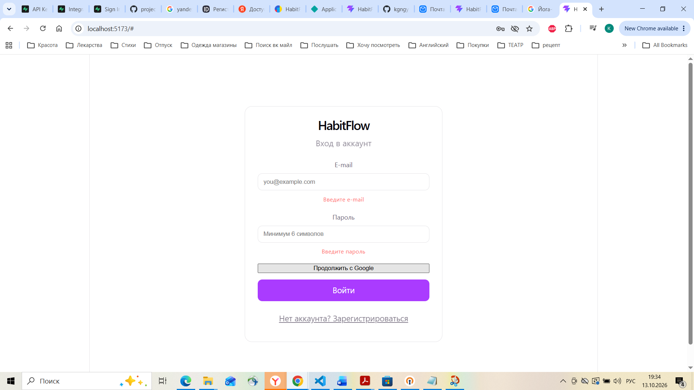
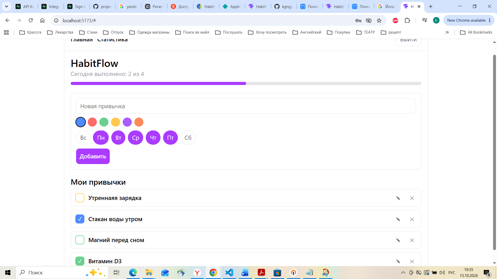
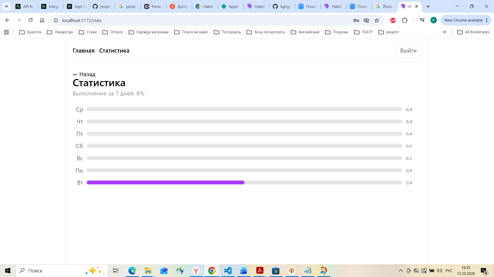

# HabitFlow — трекер привычек


🔗 **Живой деплой:** [https://habitflowk.netlify.app/ ]

Полнофункциональное веб-приложение для отслеживания привычек:
**React + TypeScript + Vite** на фронтенде и **Supabase**
(PostgreSQL + Auth + RLS + PostgREST) на бэкенде.

---

## Возможности

- **Аутентификация**
  - Регистрация и вход по e-mail (Supabase Auth, подтверждение e-mail).
  - Вход через **Google OAuth2** в один клик.
- **Управление привычками** (CRUD)
  - Создание, редактирование, удаление привычек.
  - Настройка цвета и дней недели для каждой привычки.
  - Отметка выполнения «на сегодня».
  - Статистика выполнения за 7 дней.
- **Безопасность**
  - Row Level Security: каждый пользователь видит только свои данные.
  - Валидация данных на клиенте и в БД (CHECK-ограничения).
- **Интеграции**
  - **Аналитика:** Яндекс.Метрика (счётчик 113375340).
  - **Логирование:** структурированный JSON-логгер + опциональная таблица `app_logs`.
  - **Мониторинг:** health-check (`public/health.json` + Supabase Edge Function).
- **Адаптивный дизайн** — работает на десктопе, планшете, мобильных.

---

## Технологии

| Слой | Стек |
|---|---|
| Frontend | React 19, TypeScript, Vite 8, React Router 7 |
| Стили | CSS (адаптивная вёрстка) |
| Тесты | Vitest 5, Testing Library, jsdom |
| Линтер | Oxlint |
| Backend | Supabase (PostgreSQL 15+, PostgREST, Auth) |
| Безопасность | RLS-политики, JWT, CHECK-ограничения, GRANT-роли |
| DevOps | GitHub Actions (CI/CD), Netlify (деплой), UptimeRobot (мониторинг) |
| Аналитика | Яндекс.Метрика |

---

## Скриншоты

### Страница входа


### Главная — список привычек


### Статистика за 7 дней



---

## Структура проекта

```
habitflow/
├── .github/workflows/ci-cd.yml  # CI/CD: lint → test → build → audit → deploy
├── 001_init.sql                 # миграция: profiles, habits, check_ins + RLS
├── 002_logs.sql                 # таблица app_logs (опционально)
├── netlify.toml                 # конфиг деплоя на Netlify
├── .env.example                 # шаблон переменных окружения
├── public/health.json           # health-check (liveness)
├── docs/                        # документация и скриншоты
│   ├── project-plan.md
│   ├── user-stories.md
│   ├── ui-concept.md
│   └── screenshots/             # скриншоты интерфейса
├── supabase/functions/health/   # Edge Function: health-check с проверкой БД
└── src/
    ├── lib/                     # supabase, auth, oauth, api, analytics, logger
    ├── components/              # HabitForm, HabitList, ProgressBar
    ├── pages/                   # HomePage, StatsPage, LoginPage
    └── test/                    # setup для Vitest
```

---

## Быстрый старт

### Требования

- **Node.js >= 22.22.2** (рекомендуется 24 LTS). См. `.nvmrc`.
- **npm** или **pnpm**.
- Аккаунт **Supabase** (бесплатный).

### Установка

```bash
# 1. Установить зависимости
npm install

# 2. Скопировать шаблон окружения
cp .env.example .env          # macOS / Linux
# или
copy .env.example .env        # Windows (cmd)
Copy-Item .env.example .env   # Windows (PowerShell)

# 3. Заполнить .env реальными значениями (см. ниже)

# 4. Запустить dev-сервер
npm run dev
```

Приложение откроется на http://localhost:5173

### Переменные окружения

Файл `.env` (не коммитится в Git):

```bash
# Supabase — обязательны
# Project Settings → API в дашборде Supabase
VITE_SUPABASE_URL=https://<project-ref>.supabase.co
VITE_SUPABASE_ANON_KEY=<anon-public-key>

# Яндекс.Метрика — опционально
VITE_YM_COUNTER_ID=<номер-счётчика>

# Уровень логирования: debug | info | warn | error
VITE_LOG_LEVEL=info
```

### Настройка базы данных

1. Создайте проект на https://supabase.com (New project).
2. Откройте **SQL Editor → New query** и выполните `001_init.sql` (создаст
   таблицы `profiles`, `habits`, `check_ins`, триггеры и RLS-политики).
3. Опционально: выполните `002_logs.sql` для таблицы логов.

### Настройка OAuth (Google)

1. Google Cloud Console → создайте OAuth Client ID (Web application).
2. **Authorized redirect URI:** `https://<project-ref>.supabase.co/auth/v1/callback`.
3. Supabase → **Authentication → Providers → Google** → включите, вставьте
   Client ID и Client Secret.
4. Supabase → **Authentication → URL Configuration** → добавьте
   `http://localhost:5173` и домен деплоя в Redirect URLs.

---

## Скрипты

| Команда | Назначение |
|---|---|
| `npm run dev` | Dev-сервер Vite (http://localhost:5173) |
| `npm run build` | Production-сборка (`tsc -b && vite build`) |
| `npm run preview` | Локальный просмотр production-сборки |
| `npm test` | Тесты (Vitest + Testing Library) |
| `npm run lint` | Линтер Oxlint |

---

## Архитектура

### База данных

| Таблица | Назначение | Связи |
|---|---|---|
| `profiles` | Публичный профиль (1:1 с `auth.users`) | FK → `auth.users.id`, CASCADE |
| `habits` | Привычки пользователя | FK → `auth.users.id`, CASCADE |
| `check_ins` | Отметки выполнения по дням | FK → `habits.id`, CASCADE |

**Ограничения целостности:**
- Уникальность отметки: `unique (habit_id, date_key)`.
- Валидация имени (1–100 символов), цвета (HEX), дней недели (0–6).
- Триггер `handle_new_user` — автосоздание `profiles` при регистрации.

**Безопасность:**
- RLS включён на всех таблицах.
- Пользователь видит только свои данные (`auth.uid() = user_id`).
- `anon` не имеет прав на таблицы; `authenticated` — только нужные операции.

### Frontend

- `src/lib/api.ts` — обёртка над Supabase PostgREST, маппинг ошибок в `AppError`.
- `src/lib/auth.ts` — регистрация, вход, выход, отслеживание сессии.
- `src/lib/oauth.ts` — Google OAuth через Supabase Auth.
- `src/lib/analytics.ts` — события Яндекс.Метрики.
- `src/lib/logger.ts` — структурированный JSON-логгер.

### Backend (Supabase)

- PostgreSQL 15+ с RLS-политиками и триггерами.
- Auth: e-mail + пароль, OAuth2 (Google), JWT-сессии.
- PostgREST автоматически даёт REST API для таблиц.

---

## CI/CD

Pipeline в `.github/workflows/ci-cd.yml`:

```
push/PR в main
  └─ job ci:   checkout → setup-node(22) → npm ci → lint → test → build → audit
  └─ job deploy (только push в main):  build → deploy to Netlify
```

**Секреты GitHub Actions** (Settings → Secrets and variables → Actions):

| Секрет | Значение |
|---|---|
| `VITE_SUPABASE_URL` | Project URL из Supabase |
| `VITE_SUPABASE_ANON_KEY` | anon public key из Supabase |
| `VITE_YM_COUNTER_ID` | Номер счётчика Яндекс.Метрики |
| `NETLIFY_AUTH_TOKEN` | Personal access token из Netlify |
| `NETLIFY_SITE_ID` | Site ID из Netlify |

---

## Безопасность

- **Аутентификация:** Supabase Auth (JWT, `autoRefreshToken`, `persistSession`).
- **Авторизация:** RLS-политики на всех таблицах.
- **Валидация:** CHECK-ограничения в БД + клиентская валидация.
- **Секреты:** `.env` в `.gitignore`; в репозитории только `.env.example`.
- **Зависимости:** `npm audit` — 0 уязвимостей; проверка в CI.
- **Аудит:** подробный отчёт в `security_audit.md`.

---

## Мониторинг

- **Liveness:** `https://<site>.netlify.app/health.json` → `{"status":"ok"}`.
- **Readiness (БД):** Supabase Edge Function `supabase/functions/health/`.
- **Внешний мониторинг:** UptimeRobot (интервал 5 минут, алерт на e-mail).

---

## Документация

- [integration_documentation.md](integration_documentation.md) — OAuth2, аналитика, CI/CD, логирование, мониторинг.
- [backend_documentation.md](backend_documentation.md) — модель данных, API, развёртывание.
- [security_audit.md](security_audit.md) — аудит по OWASP Top 10.
- [ai-process.md](ai-process.md) — использование AI на всех этапах разработки.
- [FULL-GUIDE.md](FULL-GUIDE.md) — пошаговая инструкция «с нуля до деплоя».
- [STEP-BY-STEP.md](STEP-BY-STEP.md) — краткая пошаговая инструкция.

---

## Лицензия

Учебный проект. Свободно используйте код в своих целях.
